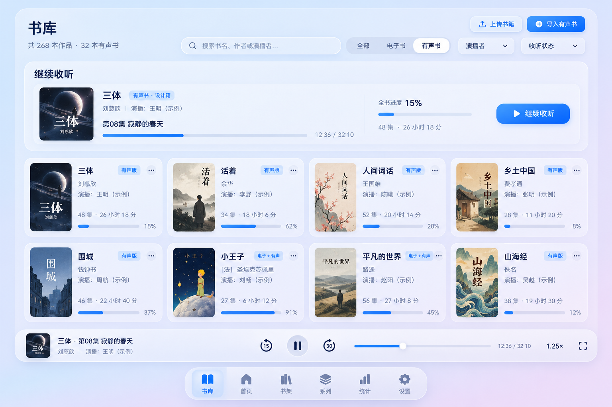
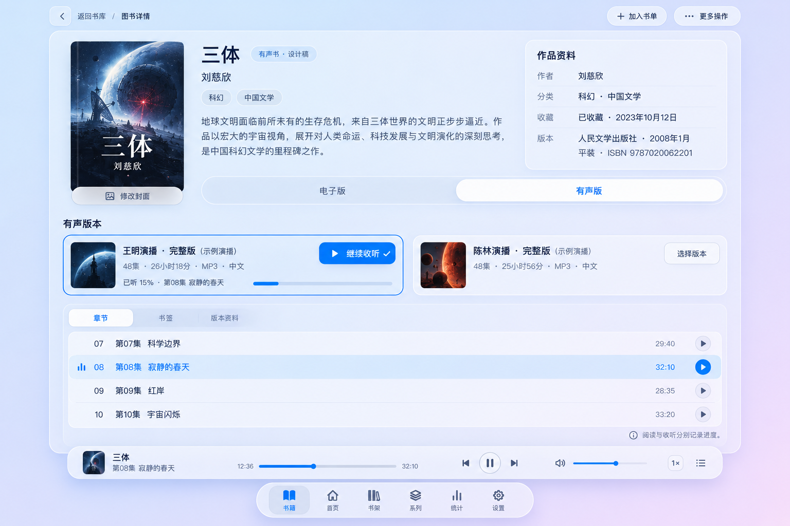
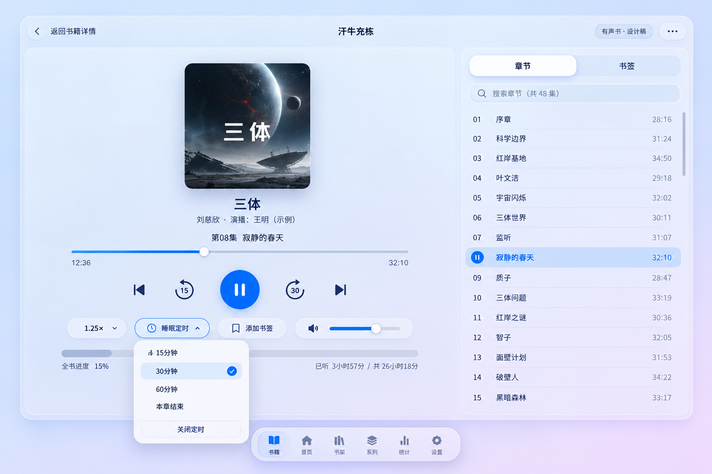
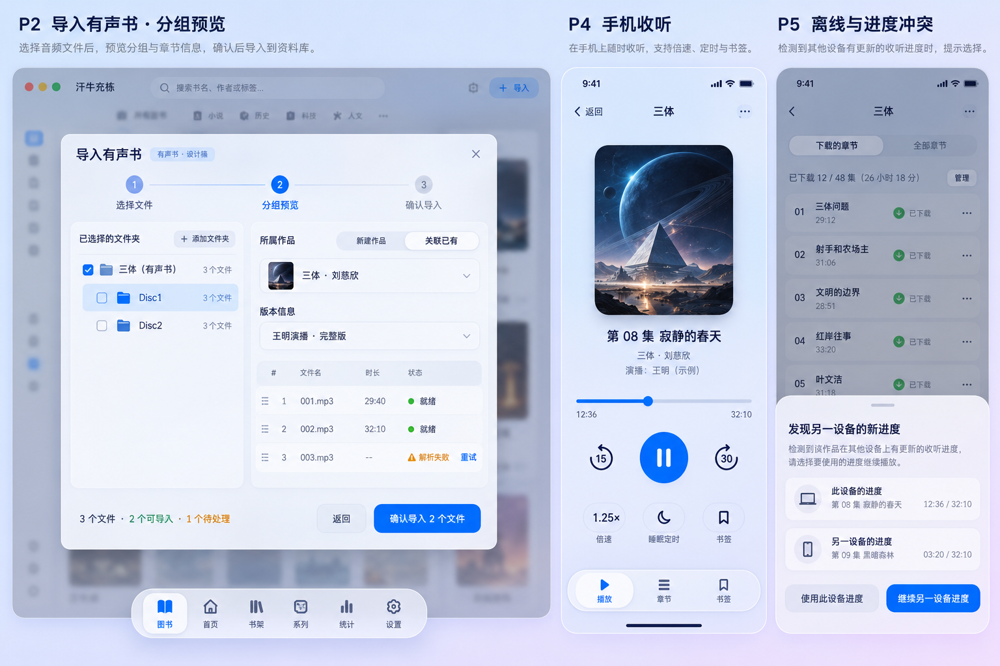

# 有声书 UI 设计资料

需求：[REQ-20261029-001](../../audiobook-requirements.md)。设计归档日期：2026-10-29；归档版本：1.47.93。

本目录为待开发功能的概念设计，不是运行截图或已完成功能。采用内置 image_gen 生成，完整提示词见 [prompts.md](prompts.md)。书籍、演播者、数量、时长和进度均为示例数据。

## 设计依据

- 当前默认主题来自 frontend/src/stores/theme.ts：macos26。
- 色彩来自 frontend/src/types/theme.ts 与 frontend/src/styles/themes.css：背景 #DCEBFA → #F1E4F8、强调色 #007AFF、半透明白色表面。
- 桌面导航参考 frontend/src/layouts/DockLayout.vue，保留底部浮动 Dock。
- 书库参考 frontend/src/views/BooksView.vue 的页面标题、操作区、筛选和书籍卡片。
- 详情参考 frontend/src/views/BookDetailView.vue 的返回书库、左侧封面、中部资料、侧栏和多版本布局。
- 辅助查看了现有浅蓝灰阅读器运行截图以核对中文排版；该阅读主题不替代 macos26 全局主题，不将阅读器专属顶栏视为默认全局导航。

## 设计图索引

| 图 | 内容 | 对应阶段 |
|---|---|---|
| [01 有声书书库](01-library.png) | 统一书库、媒体类型筛选、继续收听、卡片标签、迷你播放器与 Dock | P3 |
| [02 详情与版本](02-detail.png) | 电子/有声版本切换、演播版本、独立听书进度与章节 | P1—P3 |
| [03 桌面播放器](03-player.png) | 音轨进度、全书进度、倍速、书签、章节列表与睡眠定时 | P3 |
| [04 导入与移动端](04-import-mobile.png) | 分组预览、失败文件处理、手机播放和离线进度冲突 | P2 / P4 / P5 |

## 实施时必须保持的交互规则

1. 当前主题的布局、颜色、封面隐私及账户偏好继续生效；其他主题复用各自 token，不把设计图配色硬编码到业务组件。
2. 阅读/收听、章节/书签等互斥项采用滑块分段控件；下载、回收等独立动作不附加选中滑块。
3. 迷你播放器位于 Dock 上方，内容留出底部空间；窄屏适配安全区域，不能覆盖列表末行或关键按钮。
4. 章节进度、全书内容位置和实际收听时长分别计算；图中数字不作为默认或真实统计。
5. 播放与暂停按真实状态显示；完整播放器打开时不同时叠加另一套迷你播放控制。
6. 睡眠定时具有明确关闭入口和剩余时间；当前计时归属会话，常用长度可保存到账户。
7. 导入预览显示可导入/失败数量；图中仅导入成功探测的文件是需用户明确确认的部分导入，不静默丢失失败文件。
8. 新设备接管及离线冲突需保留双方位置供选择；不同演播版本不自动按章节或百分比同步。
9. 手机概念图覆盖 P4，离线冲突覆盖 P5，不作为首个 Web 版本已支持能力。
10. 字体、屏幕密度、系统媒体控件及图片生成细节会与最终实现不同；准确交互、阶段范围、文案和可访问性以需求正文及本索引为准。Android 按钮点击态不使用阴影。

## 图片审阅与实施校正

已检查四张图片的视觉布局，文件尺寸与 SHA-256 记录见 [manifest.json](manifest.json)。生成图中的书封、局部图标、章节示例名和播放状态仅用于表达层次，不是像素级实现契约。详情中的“继续收听”指回到当前收听会话；实际播放状态统一由全局播放器控制。桌面图中“已听3小时57分”表示全书内容位置，落地时改为“内容位置 3小时57分”，实际收听时长另列统计。章节列表的当前序号应始终显示，不以播放图标完全替代序号。导入图的文件夹计数和离线列表中章节示例不作为一致性样本；实际实现按真实文件统计，模态背景沿用现有页面，不额外增加侧边栏。

## 状态与空态补充

- 未收听：显示“开始收听”，不伪造上次进度。
- 缺失音轨或不兼容编码：定位异常文件并允许重新探测，不清除进度、不自动转码。
- 加载/缓冲：明确显示状态，暂停实际收听计时；网络错误保留续播位置并提供重试。
- 尚无有声版本：显示添加入口；纯有声书隐藏电子书专属操作。
- 无权限、版本回收或凭证失效：终止新读取并提示，不展示其他账户资料。
- 断网：P3 提示连接失败；P5 对已完整缓存音轨提供离线播放，未缓存内容不得假装可用。

## 预览

### 统一书库

### 详情与演播版本

### 桌面播放器

### 导入与移动端

