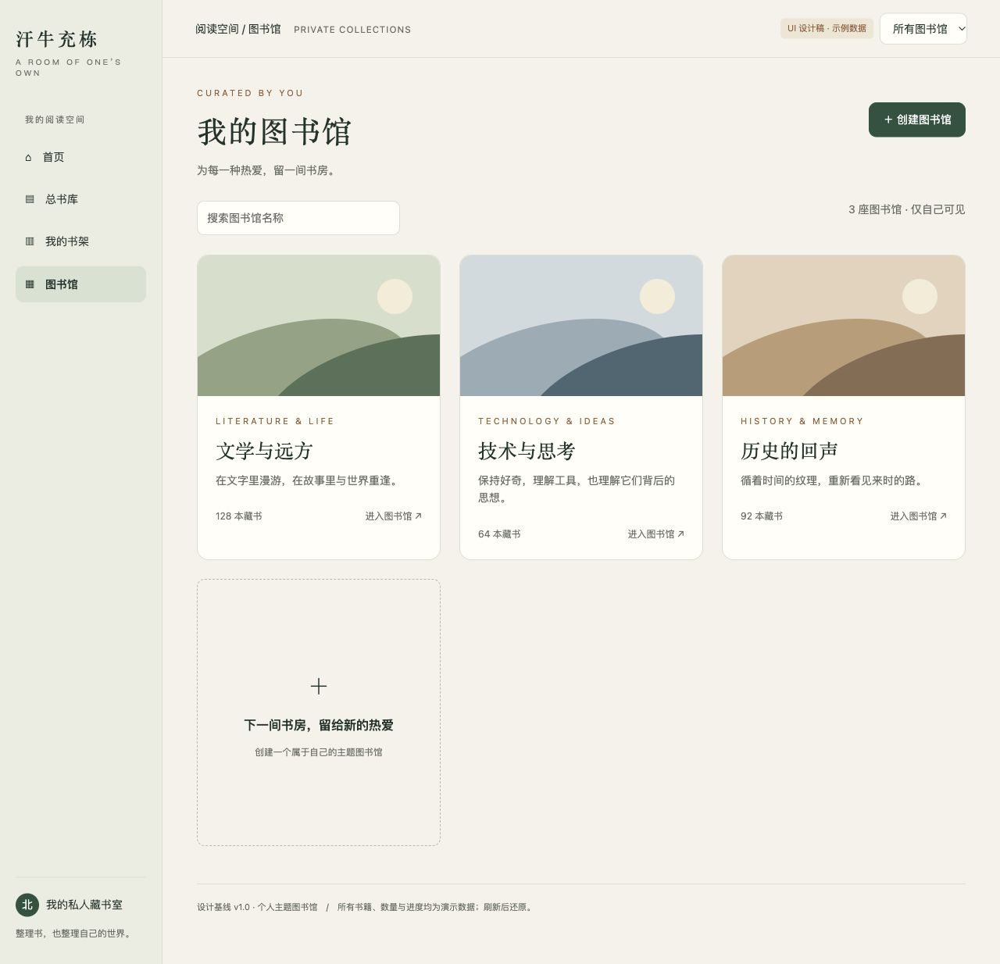
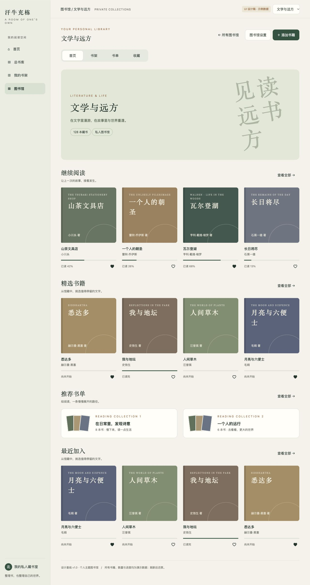
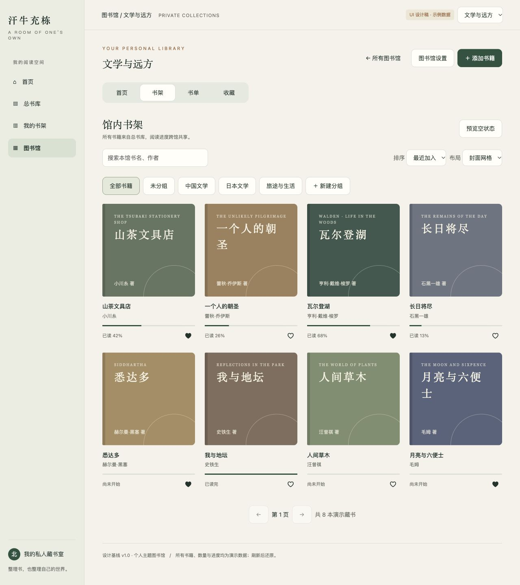
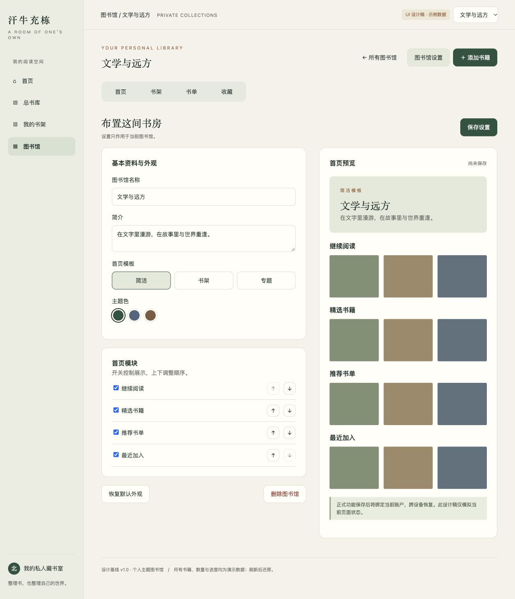
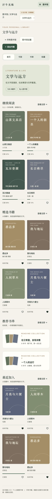
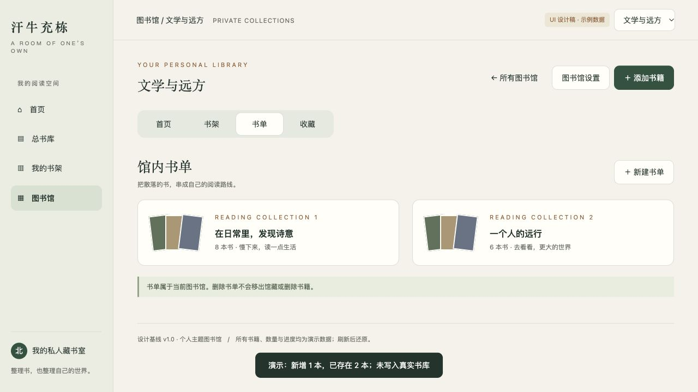
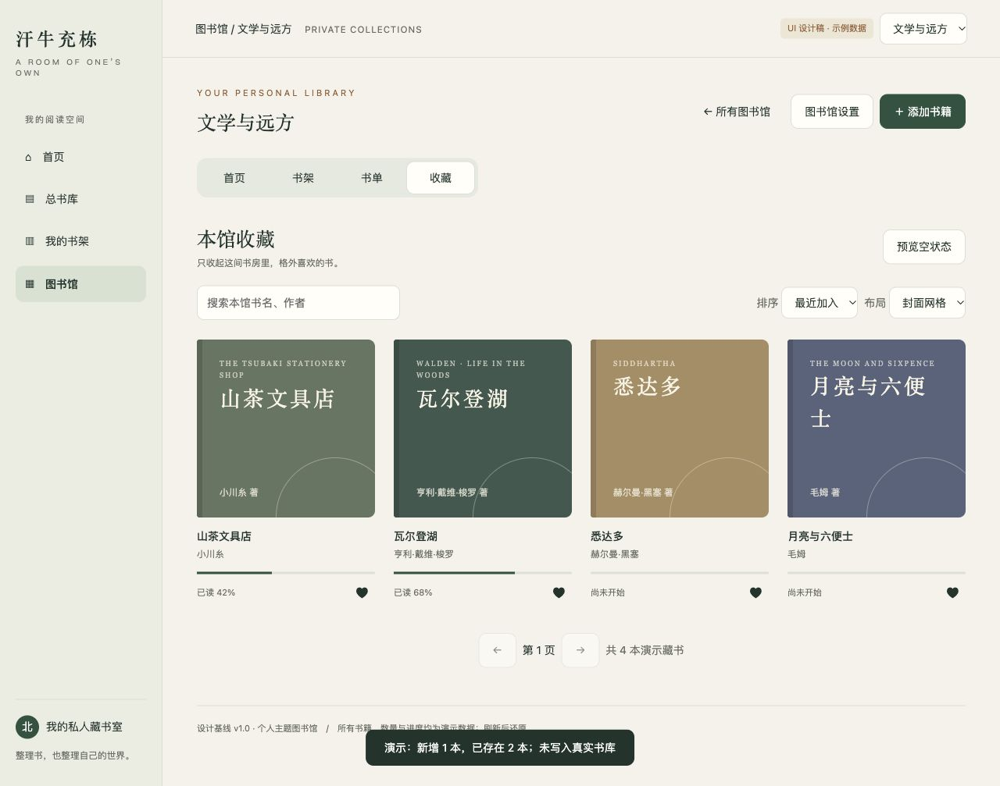

# 个人主题图书馆 · UI 设计

- 日期：2026-10-29
- 设计版本：1.0
- 需求基线：[个人主题图书馆需求文档](../../library-requirements.md)
- 交互稿：[ui-prototype.html](ui-prototype.html)，用浏览器直接打开即可，无需安装依赖或联网。
- 交付性质：独立界面设计稿；未接入业务 API，未修改现有应用页面。

## 1. 设计方向

“为每一种热爱，留一间书房”。采用暖纸底色、深墨绿主色、宋体标题和简洁正文，以书封与书单作为视觉主体。系统操作区克制，图书馆有自己的主题身份。

示例书封和山景使用本地 CSS 绘制，无外链图片、字体或脚本依赖。实际实现使用书籍现有封面，缺失封面沿用系统占位机制。

| 元素 | 设计规格 |
|---|---|
| 画布 / 卡片 | `#F6F4ED` / `#FFFEF9` |
| 正文 / 次级文字 | `#253B33` / `#73786E` |
| 主色 / 分隔线 | `#325E49` / `#E0E3D8` |
| 备选主题 | 雾蓝 `#5C718A`、暖棕 `#89664C` |
| 标题 | 系统宋体，桌面主标题 38px，手机 29px，模块标题 25px |
| 正文 | 系统无衬线，14px；辅助说明 11–12px |
| 间距 | 常用 8 / 12 / 16 / 24 / 32px；桌面内容边距 44px，手机 18px |
| 圆角 | 操作按钮 10px，面板 14px，馆头 16px；书封保持书籍轮廓 |
| 反馈 | 颜色、边框、焦点环；按钮点击无按压阴影 |

具体色值是该模板的设计起点，正式开发须纳入已有主题系统，检查各主题的对比度，不能全局覆盖原系统主题。

## 2. 页面设计

| 页面 | 结构和重点 |
|---|---|
| 图书馆列表 | 系统侧栏、页面标题与创建按钮、馆名搜索、山景封面馆卡片、创建占位卡 |
| 馆首页 | 馆切换、馆管理操作、四项滑块分段控件、馆头、继续阅读、精选、推荐书单、最近加入 |
| 馆书架 | 分组筛选、搜索、排序、网格/列表切换、进度与本馆收藏操作、分页位置 |
| 馆书单 | 组合书封、书单标题与简介、新建入口；打开示例书单可查看详情布局 |
| 馆收藏 | 复用书架卡片，明确“本馆收藏”，收藏开关与阅读进度同时可见 |
| 图书馆设置 | 左侧资料/模板/主题/模块配置，右侧实时预览；保存、恢复默认与危险操作分开 |
| 添加书籍 | 模态框展示目标馆，已添加项禁用、待添加项勾选，明确不复制文件 |
| 删除/移出确认 | 区分馆内组织数据与原书、文件、阅读记录，保留取消入口 |
| 空状态 | 标题、简短解释、从书库添加主按钮；搜索无结果时提示调整关键词 |

## 3. 桌面与手机布局

- 桌面保留系统侧栏，页面内容最大宽度 1330px；馆卡三列，书封四列，书单两列，设置采用编辑与预览双栏。
- 1050px 以下侧栏缩窄，馆卡两列、设置单栏。
- 700px 以下使用精简顶部品牌与图书馆入口，馆卡/书单单列、书封两列，操作自动换行，设置预览移到配置下方。
- 馆内四项分段控件保持滑动指示器，键盘左右键/Home/End 切换，提供可见焦点和减少动态效果支持。
- 弹窗最大高度为视口的 85%，可滚动；Escape 关闭，使用原生 dialog 的焦点约束。
- 操作不依赖悬停，手机可直接访问。设计稿在 390px 宽视口检查首页，无整页横向溢出。

## 4. 交互覆盖与边界

可演示：馆名搜索、进入/切换馆、创建及重名校验、四栏目切换、书架分组与搜索、排序、网格/列表、馆内收藏切换、示例书单进入与返回、主题色/名称/简介预览、首页模块开关与上下移动、添加选择、空状态、删除与恢复确认。

设计稿中的馆数量、书量和书单计数为展示用示例；各馆复用一套样例书目。原书库、阅读器、分组/书单新建只展示入口或提示；添加及删除只演示流程，不实际改动示例馆藏。收藏与展示配置在当前页面内按馆隔离，刷新后还原。

模板按钮目前展示选中及模板标签；完整的三模板布局、封面选择、批量多馆选择、手工排序、分页、保存冲突、离页草稿提示及服务端持久化按需求文档实现，不能将此稿作为这些能力已经完成的依据。

本稿用于确认视觉层级与主要路径。需求文档是数据规则和验收范围的权威来源；原型的局部演示不缩减需求。

## 5. 设计截图

以下截图由交互稿在浏览器中生成，供无需启动预览时快速查阅；全页图适合放大查看。

### 图书馆列表 · 桌面

### 馆首页 · 桌面

[首屏预览](screenshots/08-home-viewport.jpg)

### 馆书架 · 桌面

### 图书馆设置 · 桌面

### 馆首页 · 手机（390px）

### 馆书单 · 桌面

### 馆收藏 · 桌面

