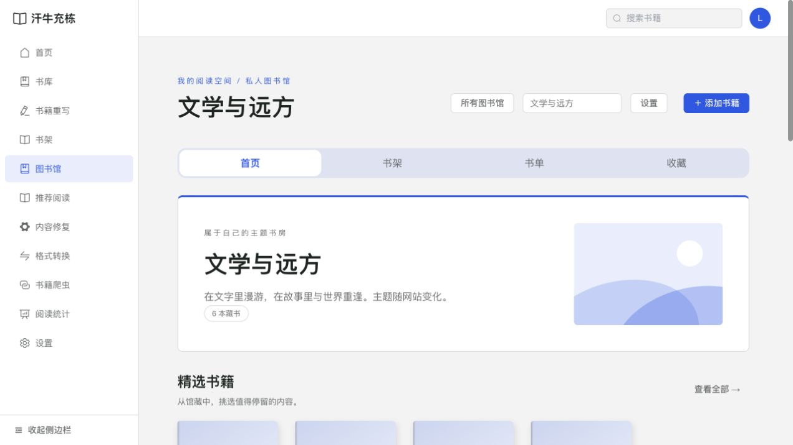
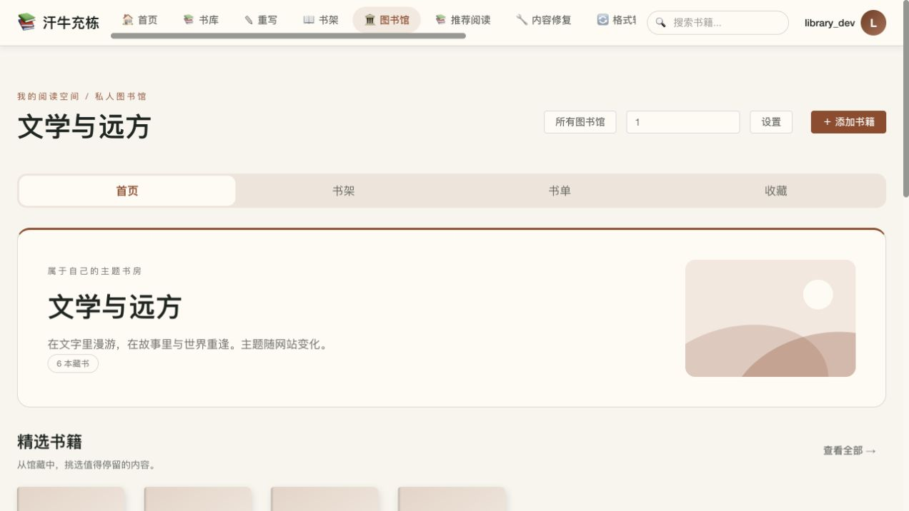

# 个人主题图书馆 · Web 实现与验收

- 日期：2026-10-29
- 关联需求：REQ-20261029-007
- 需求基线：[library-requirements.md](../../../library-requirements.md)
- 范围：Web 首期，独立个人馆；未进行 NAS 部署或原生客户端馆管理开发。

## 实现内容

- 新增 `/libraries` 及馆内首页、书架、书单、书单详情、收藏、设置路由；接入现代侧栏、暖色顶部导航、自然主题和 MACOS 26 Dock、手机导航。
- 旧账户的导航设置补齐新入口，保留既有标题、显示开关和排序。
- 馆藏关联引用原书，不复制文件；原有个人书架、全局书单和收藏保持独立。书籍详情中的原有操作仍表示全局操作。
- 首页最多四种可排序模块，按真实馆藏/进度读取；精选最多 12 本、推荐书单最多 6 个，无数据模块隐藏。
- 支持多馆批量选书、候选书籍分页及已添加识别、结果统计与失败重试；单次最多 20 馆、200 本。
- 支持分组、书单、馆内收藏、筛选、分页、跨页相邻手工排序，以及删除与移出确认。
- 设置保存至服务端，含修订号冲突校验；布局/分页偏好也由服务端保存。无已登录配置仅保存在 localStorage 的新增路径。
- 图书馆配置只控制馆内组织与局部外观；页面表面、文字、主按钮、导航、分段控件继承当前网站的 CSS 变量与已有组件。默认主题色是跟随网站；其他点缀色使用全站语义色，仅应用馆头边缘，不覆写 `--primary`、根主题、阅读器或全局导航。
- 新增表通过可重复运行的启动初始化器创建；所有者和馆内关系有外键与唯一约束；回收只隐藏关系，恢复可见；彻底删除墓碑前清理关系；现有书籍合并事务迁移并去重。
- 完整数据库 `pg_dump` 自动包含新表，旧备份恢复并启动新版本后可创建空馆结构。

## 开源方案核对

本次不引入依赖、不复制开源代码、不部署新的服务，沿用项目已有 Vue、Element Plus、Spring JDBC/JPA 和 PostgreSQL。

| 候选 | 匹配度及许可证 | 维护/安全评估 | 资源与集成判断 |
|---|---|---|---|
| [Komga](https://github.com/gotson/komga) / [Libraries 文档](https://komga.org/docs/guides/libraries/) | MIT；具备图书馆、书单与进度能力，但其馆以不重叠根目录组织 | 仓库、开发与安全文档可访问；未独立开展漏洞审计或版本安全认证 | 虽同属 Spring 生态，直接引入仍需独立扫描/元数据/进度模型；与多馆引用一本既有书的目标不同，未做 NAS 资源实测 |
| [Calibre-Web](https://github.com/janeczku/calibre-web) | GPL-3.0；具备自定义 shelves，依赖 Calibre 数据库及其服务体系 | 公开仓库、用户文档与安全政策可访问；未将其视为已通过本项目安全审计的依赖 | 接入会增加数据库/服务适配与运维边界，不能直接复用现有 PostgreSQL 和账户进度；未做资源实测 |
| 既有项目组件 | 沿用本项目已经使用的依赖与许可证范围 | 不增加外部执行、远程资源或脚本入口；配置枚举及数量由服务端校验 | 不新增服务；复用已有阅读器、封面隐私、书名显示偏好及主题系统，集成成本最低 |

以上为功能集成判断，未作“无漏洞”或特定 NAS 占用的保证。以后如拟引入上述代码或服务，仍须先说明范围和风险并取得确认。

## 验证证据

### 自动检查

- 后端 48 项针对性测试通过：`LibraryServiceTest`、`LibraryDatabaseTest`、`UserServiceTest`、`BookServiceRecycleBinTest`、`BookVersionAggregationServiceTest`、`ReadingProgressServiceTest`、`BookListServiceTest`。
- 其中 6 项为真实 PostgreSQL 集成测试：账户/馆隔离、重复与部分失败、共享进度、回收恢复、关系清理、合并去重、配置修订、排序、原子批量回滚，以及大馆分页基线。
- PostgreSQL 集成测试仅在明确设置 `LIBRARY_TEST_DATABASE_URL`、`LIBRARY_TEST_DATABASE_USER`、`LIBRARY_TEST_DATABASE_PASSWORD` 时运行；每项使用随机 schema 并清理，不允许指向生产库。其他环境默认跳过这些测试。
- 前端 Vite 生产构建通过；保留既有依赖注释及大分包提示。
- `npm run test:user-guide` 通过（34 章）；`test:library-book-merge`、`test:book-detail-layout` 通过。
- 项目现有 `vue-tsc` 1.x 与当前已安装 TypeScript 不兼容，`vue-tsc --noEmit` 在启动阶段报 `Search string not found`，未完成独立类型检查；本次没有为修复工具链引入新依赖。

### 浏览器与实际接口

使用独立测试库、临时文件目录和一次性账户，未修改现有服务或用户真实书籍。

- 创建馆并进入空状态；使用正式上传/API 加入六本原创测试文本。
- 馆首页、推荐书单进入详情、馆内收藏、分组创建、设置保存后刷新恢复。
- 设置直达页的草稿初始化问题已修复并回归；未保存离开确认可触发。
- 已加入候选显示禁用与“已添加”，不会重复勾选。
- 四套网站主题均通过账户服务端设置切换并确认实际根主题；截图见下方。
- 390px 手机首页、书架和设置页的文档宽度与视口均为 390px，无整页水平溢出。
- 验证完成时未发现新增控制台错误；部分更细的批量/并发/清理规则以数据库测试覆盖，不宣称所有流程均已做浏览器逐项测试。

### 数据与性能

- 本机隔离 PostgreSQL 环境，单账户 100 馆、总书库 10,000 本、单馆 5,000 本；预热 1 次后采样 15 次，书籍页 + 馆列表页 + 首页组合查询 P95 约 667ms，通过本地开发门槛 2 秒。该门槛用于开发回归，不等同真实 NAS 性能承诺。
- 对完整测试库执行 PostgreSQL custom 格式导出，并在另一新建测试库恢复；核对 3 个馆、6 条馆藏和 3 条书单成员恢复，外键约束恢复成功。
- 未执行真实 NAS、跨物理设备、数据库故障、离线客户端进度冲突及所有浏览器/辅助技术验收；跨馆沿用既有进度与版本同步规则，没有新增换算或合并策略。

## 实装截图

以下为真实开发页面，使用测试账户和原创测试数据，与离线原型截图分开保留。

### 现代简约

### 暖色文艺

### MACOS 自然主题

### MACOS 26

### 手机

